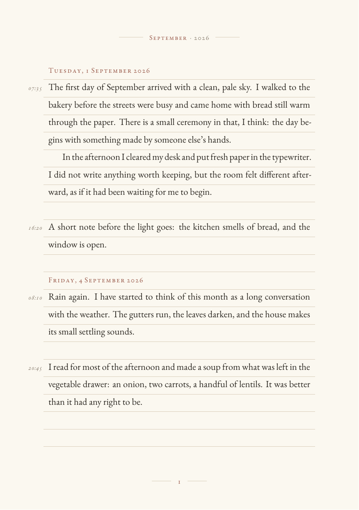

# diary

A small, terminal-first journal. Write in plain text; get back a quiet,
ruled monthly PDF set in EB Garamond on warm cream paper.

Source: <https://github.com/Anaspiringdesigner/diary> · AUR: `diary`



## Use

```sh
diary                      # write in $EDITOR
diary "A line for today"   # quick entry
echo "A line for today" | diary

diary edit                 # edit this month's entries.md
diary open                 # open this month's PDF
diary build                # rebuild it
diary list                 # list months
diary --help               # everything else
```

Entries are grouped by day. Each entry added with `diary` is stamped with the
local 24-hour time when it is saved, and that time is printed in the left
margin. Entries you add by hand without a time remain untimed.

To write into an older day, use `--date`: the date is backdated, while the time
is the current local time.

```sh
diary --date 2026-10-20 "A note I forgot to add."
```

Quick entries passed as arguments end up in your shell history. For anything
private, run `diary` with no arguments and write in the editor.

Options belong before the text. If an entry starts with a word that looks like
a command, or with a dash, separate it with `--`:

```sh
diary -- "open"
diary -- "- a thought for the morning"
```

## Where things live

```
~/Documents/diary/
  2026-10 October/
    entries.md              # the source; safe to edit by hand
    October 2026.pdf        # the typeset month
    .build/                 # generated .tex and log (disposable)
```

The PDF is replaced atomically after each new entry. The script opens it with
`xdg-open` by default; pass `--no-open` or set `DIARY_NO_OPEN=1` to suppress
that.

New diary folders and files are created private (mode `700`/`600`), since a
diary is nobody else's business.

`entries.md` is the source of truth. Back up `~/Documents/diary` and the whole
journal can be rebuilt.

Use `--month YYYY-MM` with `edit`, `open`, or `build` to work on another month:

```sh
diary open --month 2026-09
```

## Entries

`entries.md` is deliberately simple:

```md
# October 2026

## 2026-10-22

### 09:12

A first paragraph. A blank line starts a new paragraph.

A second paragraph. *Italics* and **bold** work. Straight quotes, apostrophes,
double hyphens, and ellipses are turned into typographic characters.

### 21:40

A later entry on the same day.
```

Date headings must be `## YYYY-MM-DD`, and an optional time heading is
`### HH:MM` in local 24-hour time. `diary` writes these automatically; you can
also add one by hand in `diary edit`. Any text directly under a day heading
without a time is treated as an untimed entry, so older files keep working.
The body is escaped before it reaches LaTeX, so characters such as `%`, `&`,
`$`, `#`, `_`, `{`, `}`, `~`, `^`, `<`, and `>` are safe to type. The `##`
and `###` heading markers are reserved; quick entries that begin with them are
kept as prose automatically.

The PDF has 22 ruled lines per page. Each entry's time sits in the left margin
beside its first line, and separate entries on the same day are divided by one
blank ruled line. If an entry is longer than the page, it flows onto the next
page at the same line rhythm. Each date is also a PDF bookmark, so the viewer's
sidebar works as an index.

## Install

### Arch Linux (AUR)

```sh
paru -S diary
```

The package installs the command, its man page, desktop entry, and the LaTeX
template under `/usr/share/diary`.

### From a clone

The command is linked into `~/.local/bin`:

```sh
./install.sh
```

Requirements:

- Python 3 (standard library only)
- [Tectonic](https://tectonic-typesetting.github.io/) for typesetting

On Arch, install Tectonic with `sudo pacman -S tectonic`. It does not need a
system TeX Live installation; the first build downloads only the packages and
fonts it needs into `~/.cache/Tectonic`.

If you prefer a self-contained binary, put a Tectonic release in
`~/.local/bin/tectonic` and the diary will find it there.

## Customize

The design lives in [`template.tex`](template.tex). The five colours at the top
of the file restyle everything. A few useful knobs:

- `a5paper`, margins, and `topskip` in the `geometry` block
- `\fontsize{11pt}{7.2mm}` for body size and leading
- `\topskip=6mm` and the background loop for the ruled grid
- `LetterSpace` and sizes for the date and header typography
- `\entrytime` for the small margin time, and `\diaryentrygap` for the space
  between entries on the same day

Rebuild after editing:

```sh
diary build
```

To see the fully expanded LaTeX for the current month, look at:
`~/Documents/diary/YYYY-MM Month/.build/diary.tex`.

The page grid is tuned for A5 and 7.2 mm leading. If you change the leading,
update the rule positions in the background loop (`32.8 + i * 7.2`) by the same
amount so the writing continues to sit on the rules.

## Environment

| Variable | Purpose |
| --- | --- |
| `DIARY_DIR` | Override the diary root (default `~/Documents/diary`) |
| `DIARY_TEMPLATE` | Override the LaTeX template path |
| `DIARY_TECTONIC` | Use a specific Tectonic binary |
| `DIARY_EDITOR` | Editor for entries (falls back to `$VISUAL`, then `$EDITOR`) |
| `DIARY_NO_OPEN` | Set to `1` to never launch the PDF viewer |

## License

MIT. See [LICENSE](LICENSE).
